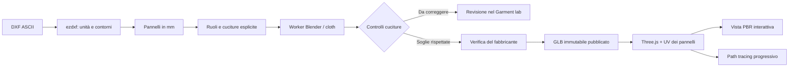

# DreamTeam: ricerca e stato del motore 3D

Ricognizione del 20 ottobre 2026. Il prodotto è dedicato alle divise delle squadre di calcio. La reference visiva fornita è [Oneiros](https://oneirosdream.com/), ispezionata nel browser: palette scura, accenti freddi e centralità della visualizzazione. Per la densità degli strumenti sono stati studiati anche [Linear](https://linear.app/now/how-we-redesigned-the-linear-ui) e il [redesign di Krea](https://www.krea.ai/blog/redesign). La landing con filmato e scroll resta una fase successiva.

## Repository e componenti

| Progetto                                                                                               | Parte utile                                                                              | Licenza osservata / dipendenze                                                                                                            | Decisione attuale                                                                                                                                                                                            |
| ------------------------------------------------------------------------------------------------------ | ---------------------------------------------------------------------------------------- | ----------------------------------------------------------------------------------------------------------------------------------------- | ------------------------------------------------------------------------------------------------------------------------------------------------------------------------------------------------------------ |
| [GarmentCode / PyGarment](https://github.com/maria-korosteleva/GarmentCode)                            | Rappresentazione di pannelli e cuciture, costruzione parametrica, pipeline di drappeggio | Codice MIT; richiede anche il simulatore e dipendenze Python. Le licenze di corpi, dati e modelli devono essere verificate separatamente. | Candidato principale per l'evoluzione della rappresentazione e il confronto del solver. Non è un importatore universale DXF pronto all'uso.                                                                  |
| [NvidiaWarp-GarmentCode](https://github.com/maria-korosteleva/NvidiaWarp-GarmentCode)                  | Estensioni del solver cloth per il drappeggio di cartamodelli                            | NVIDIA Source Code License for Warp, verificata nel repository; codice JIT CPU/GPU. Verificare anche le dipendenze al pin scelto.         | Candidato per il worker successivo, da misurare su una divisa e un corpo di riferimento.                                                                                                                     |
| [OpenSew 2](https://github.com/MarcelloMorettoni/opensew-2)                                            | Disposizione dei pezzi, cucitura, saldatura, assestamento e interazione in Blender       | GPL-3.0; l'autore indica Blender 5.2. Include anche asset con attribuzioni proprie.                                                       | Studiato come riferimento tecnico. Non è vendorizzato nel SaaS; il worker attuale usa direttamente le API native di Blender.                                                                                 |
| [Seamer Studio](https://github.com/ahzs645/seamer-studio)                                              | Editor di cartamodelli e simulazione XPBD WebGPU con Three.js                            | MIT. Il checkout usa pacchetti `@atelier/*` da percorsi locali e un sottomodulo per il corpo.                                             | Molto pertinente per una simulazione interattiva futura. Il motore è [Atelier](https://github.com/ahzs645/atelier), disponibile come repository separato. Richiede validare la catena di dipendenze e asset. |
| [three-gpu-pathtracer](https://github.com/gkjohnson/three-gpu-pathtracer)                              | Path tracing progressivo con materiali fisici                                            | MIT; dipende da Three.js, three-mesh-bvh e xatlas-web                                                                                     | Integrato, versione WebGL 0.0.23, con Three.js 0.186.1. Il repository principale più recente ha anche un percorso WebGPU: non sono API intercambiabili.                                                      |
| [ezdxf](https://github.com/mozman/ezdxf)                                                               | Parsing DXF, trasformazioni dei blocchi, curve                                           | MIT; Python                                                                                                                               | Integrato con versione 1.4.4.                                                                                                                                                                                |
| [Garment Tool](https://joseconseco.github.io/GarmentToolDocs/quick_guide/)                             | Interfaccia Blender per curve, cuciture e mesh di simulazione                            | Add-on distribuito separatamente dall'autore                                                                                              | Riferimento di workflow; non installato o redistribuito.                                                                                                                                                     |
| [SewFormer](https://github.com/sail-sg/sewformer) / [DressCode](https://github.com/IHe-KaiI/DressCode) | Ricostruzione/generazione di cartamodelli da immagine o testo                            | Pipeline di ricerca e dipendenze/checkpoint da verificare                                                                                 | Da studiare per un modulo AI futuro. Non risolvono da soli il caso del DXF già esistente e non sono integrati.                                                                                               |

Le decisioni sono basate sulla documentazione primaria e sull'ispezione dei checkout. Una descrizione o una demo di un repository non costituisce una verifica del suo solver. In particolare il solver completo di Seamer, GarmentCode e OpenSew non è stato eseguito in questa sessione.

## Architettura realizzata

Il renderer non deduce la forma del capo da una sagoma estrusa. Il GLB del fabbricante contiene le posizioni calcolate dal worker e UV separate per materiale/pannello. Il modello campione in `client/public/models` è invece un capo showroom originale costruito da `pipeline/showroom.py`, con corpo curvo, maniche montate, bordi e collo. È dichiarato come campione nell'interfaccia e non viene mai spacciato per il DXF caricato.

Nel worker i contorni sono campionati, triangolati con vincoli, disposti intorno a un busto parametrico e collegati attraverso molle di cucitura. Il primo passaggio usa una rest shape dei pannelli piani; segue la saldatura delle coppie vicine e l'assestamento cloth. Il busto è geometria originale generata nello script, non un corpo umano misurato o un asset anatomico di terzi. I parametri dei tessuti sono di sviluppo e richiedono calibrazione.

## Cosa è stato verificato

- Importazione del campione DXF con quattro pannelli, curve di prova, blocchi annidati, unità dichiarate e rifiuto delle unità mancanti senza scelta esplicita.
- Conservazione dei contorni importati: l'API permette di cambiare disposizione e cuciture, non di riscrivere le coordinate passando altri punti nella richiesta.
- Isolamento tra fabbricanti; clienti esclusi da contorni DXF e modelli non pubblicati; design impossibilitati a referenziare revisioni non verificate.
- Viewer GLB PBR e path tracing realmente eseguito nel browser con accumulo di campioni. Nel browser di verifica la GPU è software: il render viene deliberatamente ridotto di risoluzione. Su GPU hardware il budget è maggiore; i tempi vanno misurati sul dispositivo del cliente.
- Worker Blender 4.3.2 eseguito sul campione, con output GLB e report numerico. Non sono stati eseguiti benchmark con una GPU hardware o con DXF industriali del fabbricante.

### Risultato della prova cloth

Una prova eseguita attraverso l’API della build di produzione, con distanza particelle 18 mm e due thread ha prodotto 2.799 vertici e 5.559 triangoli in 64,49 secondi, saldando 139 dei 142 campioni di cucitura. Il gap massimo prima della saldatura è risultato 44,45 mm. Una successiva verifica diretta con la triangolazione uniforme finale ha prodotto 3.273 vertici e 6.505 triangoli in 73 secondi, con 135/142 campioni saldati e gap massimo di 60,24 mm. Entrambi i risultati sono oltre le soglie. Il risultato **richiede revisione e resta bloccato per la pubblicazione**: avere un GLB non basta a dichiarare la simulazione corretta.

La soglia corrente di pubblicazione richiede gap prima della saldatura ≤ 10 mm e almeno il 98% dei campioni saldati, più la verifica esplicita del fabbricante. Queste soglie sono controlli tecnici preliminari; non certificano assenza di autointersezioni, correttezza sartoriale, tensione del tessuto o vestibilità. L’API ha risposto HTTP 422 al tentativo di pubblicazione del campione e HTTP 200 per la sua anteprima GLB privata (2.718.528 byte). Nessun risultato di questa prova è stato pubblicato ai clienti.

Questo rende il Garment lab un **prototipo tecnico di drappeggio**, distinto dalle funzioni SaaS già operative. Non equivale a un motore CLO completo. Il risultato del campione rende necessario migliorare disposizione iniziale, mappatura degli scalfi, gestione delle collisioni e calibrazione prima di usarlo per approvare capi.

## DXF: perimetro e limiti

L'import usa [le primitive e la decomposizione di ezdxf](https://ezdxf.readthedocs.io/en/stable/disassemble.html), con [campionamento delle curve](https://ezdxf.readthedocs.io/en/stable/path.html). Supporta contorni chiusi LWPOLYLINE/POLYLINE, SPLINE, CIRCLE ed ELLIPSE e blocchi trasformati. Le curve vengono approssimate con tolleranza di 0,4 mm. Non unisce automaticamente sequenze di LINE/ARC aperti e non interpreta tacche, grading, fori o convenzioni AAMA/ASTM. Il fabbricante deve scegliere i contorni della linea di cucitura ed escludere duplicati/layer non pertinenti.

La prima costruzione supporta quattro pannelli per una maglia a manica montata. Raglan, inserti, paramonture, colletti cuciti come pannelli separati e taglie sovrapposte richiedono un'estensione della topologia. Il DXF ASCII deve essere una taglia, fino a 10 MB e 32 contorni candidati.

Le relazioni di cucitura vengono confermate nell'editor; non sono inferite in modo affidabile dai soli contorni. Anche [CLO distingue impostazioni di scala e linea di taglio/cucitura nel proprio import](https://support.clo3d.com/hc/en-us/articles/115012380628-Import-DXF). Una linea di taglio con margine non è una linea di cucitura: la simulazione la rifiuta fino a quando il fabbricante non fornisce le geometrie adatte.

Il pacchetto di sublimazione usa ancora il cartamodello di produzione approvato nel modulo dedicato. La simulazione DXF non approva né converte automaticamente le geometrie di taglio e non garantisce la registrazione della stampa attraverso le cuciture.

## Passo di validazione necessario

Acquisire una divisa di riferimento con DXF di cucitura, DXF di taglio, misure del corpo, distinta delle cuciture e proprietà meccaniche del tessuto. Confrontare silhouette, chiusura delle cuciture, allungamento e autointersezioni con un campione reale o un export CLO/Marvelous verificato. Solo dopo questo confronto scegliere se consolidare Blender o adottare la pipeline GarmentCode/Warp per la simulazione, mantenendo Three.js come viewer indipendente.
